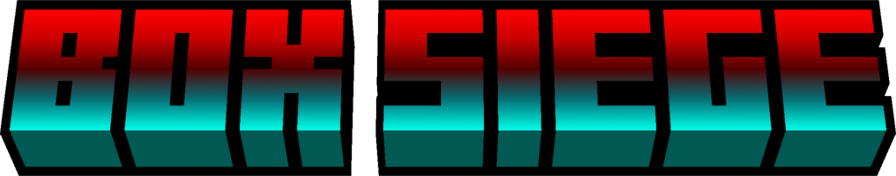

<div align="center">



# BOX SIEGE

**A Chaotic Local Multiplayer Box Brawler with a 250-Level Solo Campaign and a Built-In Replay Theater, by Equinox Interactive**

[]()
[]()
[]()
[]()
[]()
[]()

[About](#about) • [Getting Started](#getting-started) • [Game Modes](#game-modes) • [Replay](#replay) • [Controls](#controls) • [About Us Screen](#about-us-screen) • [Development](#development) • [Credits and License](#credits-and-license) • [Disclaimer](#disclaimer)

---

## About

BOX SIEGE is a fast, chaotic, arcade-style brawler where boxes fight with guns and knives on mirrored arenas. Two to four players share one screen in local Versus matches, on a single keyboard, with controllers, or with any mix of both. A solo Campaign adds 250 levels, 50 bosses, and a perk system for players who want to fight alone. Every Versus match is recorded automatically, and the built-in Replay theater lets you watch it again like a video, with kill markers, speed control, and skipping.

Every fighter has 3 hearts, every match is a first-to-N-rounds showdown, and every arena is a symmetrical trap-filled stage with its own hazards: lava, ice, crumbling platforms, spikes, arrow traps, geysers, teleport portals, conveyor belts, and spinning saw blades. Coins earned in the Campaign are spent in the Shop on character skins, weapon skins, and accessories, which can then be equipped from the Inventory.

The game is built in Godot 4.7 with GDScript and the GL Compatibility renderer, so it runs on a wide range of hardware. The whole user interface is drawn in code and shares one arcade visual identity: comic-style fonts, skewed buttons, animated screen transitions, and per-map color palettes. Every screen works with mouse, keyboard, and controller.

---

## Getting Started

The simplest way to play is to download a build from the project's release page, extract it, and run the executable. To run the game from source, see [Development](#development) below.

### System Requirements

| Item | Requirement |
|---|---|
| Operating System | Windows (x86_64), Linux (x86_64), or macOS (11 or later on Intel, 13 or later on Apple Silicon) |
| Graphics | Any GPU with OpenGL compatibility support (the game uses the GL Compatibility renderer) |
| Display | 1280x720 base resolution, scaled automatically to any window size or fullscreen |
| Input | Keyboard, one or more game controllers, or both |
| Players | 1 player (Campaign) or 2 to 4 players on one screen (Versus) |

### Startup Sequence

When the game opens, it plays a short credit sequence and then a real loading screen before the main menu appears.

| Stage | Description |
|---|---|
| Splash credits | Three slides fade in and out in order: the Godot Engine logo, the Equinox Interactive logo, and the three developers. Each slide has a background color matched to its logo. Press any key, click, or press any controller button to skip the slide that is currently showing (one press skips one slide) |
| Loading screen | Not a fake timer. All heavy work is done here with a real progress bar, so the rest of the game runs without hitches. The screen shows a procedural sunrise over a box fortress, a neon grid, floating cubes, embers, a spinning progress ring with the percentage, and four box characters running along the bar |
| Tips | A rotating gameplay tip is shown every few seconds while loading |
| Outro | At 100% the screen shows READY!, the ring charges up and becomes a portal, the view zooms into a warm flash, and the main menu opens from the center with its own logo intro |

The loading screen prepares these steps, each with its own share of the progress bar:

| Step | Share | Work Done |
|---|---|---|
| Assets | 44% | Sprites, sound effects, scenes, and music are loaded and kept in memory |
| Campaign map | 18% | The campaign scene, data for all 250 levels, font sizes, and the chain atlas |
| GPU shaders | 13% | Warm-up of additive, thin-line, polygon, particle, and menu background shaders |
| Shop and Inventory | 10% | Skin and accessory textures and their scenes |
| Synthesized sounds | 8% | Fanfare, applause, and other generated sounds, cached in `user://synth_cache` |
| Glyphs | 7% | Outlined text for the menu, Shop, and About Us screens is added to the font atlas |

The loading screen is shown for at least 3.6 seconds so the animation can be seen, and a stuck step is skipped after a timeout so the game always reaches the menu.

### Quick Play

1. Launch the game and choose **VERSUS** for local multiplayer or **CAMPAIGN** for the solo mode.
2. Pick your fighter and main weapon on the select screen.
3. Adjust the battle settings (map, time, rounds, objects, and power-ups) and start the match.
4. Win the required number of rounds to win the match.
5. Open **REPLAY** from the main menu to watch the match again.

---

## Game Modes

The main menu offers five entries: **CAMPAIGN** (1 player), **VERSUS** (2 to 4 players), **CONTROLS**, **SETTINGS**, and **QUIT**. Four extra buttons sit outside the list so they are always easy to find:

| Button | Position | Opens |
|---|---|---|
| ABOUT US | Top left, above the logo | Studio, developers, technical info, contacts, and legal notes |
| REPLAY | Top right, below the P1 to P4 indicator | The replay theater |
| SHOP | Bottom right | The cosmetic shop |
| INVENTORY | Bottom right | Equipping owned cosmetics |

### Versus

Local PvP for 2 to 4 players. The match flow is:

| Step | Screen | Description |
|---|---|---|
| 1 | Player Count | Choose 2, 3, or 4 players |
| 2 | Select | Each player picks a fighter, a main weapon, and confirms with READY. Owned skins appear as variants of each fighter |
| 3 | Teams | Only for 3 and 4 players. Players slide their cards between four team lanes to form teams |
| 4 | Battle Settings | Choose the map, time, rounds, object density, and power-up rules |
| 5 | Match | Fight until one player or team wins the required number of rounds |

At the end of a match the result screen offers **REMATCH**, **CHANGE TEAMS** (team matches only), **CHANGE FIGHTERS**, and **MAIN MENU**. The pause menu offers **RESUME**, **REMATCH**, **CHANGE TEAMS** (team matches only), **CHANGE FIGHTERS**, and **MAIN MENU**. When a team wins, the result screen shows every member of the winning team, with the most kills on top.

#### Fighter Selection

The select screen is styled after a console fighting game.

| Feature | Description |
|---|---|
| Shared roster | One grid with all 24 fighters plus a **RANDOM** cell, usable by any player |
| Player cursors | Every player has a cursor in their own color and a large portrait panel on the left or right |
| Variants | A fighter has an original look plus one variant for every skin you own |
| Duplicate rule | Players may use the same fighter as long as the fighter and skin combination is different. When every variant of a fighter is used, it is dimmed and marked **TAKEN BY Pn** |
| Flow per player | Pick a fighter, lock it in, pick a weapon, then press READY |
| Countdown | When everyone is ready, a 3-2-1 countdown starts the next screen |

### Team Battles

With 3 or 4 players, the Teams screen lets players share lanes to form teams, for example 2v2, 2v1v1, 3v1, or free-for-all 1v1v1v1.

| Rule | Detail |
|---|---|
| Team lanes | Four lanes, TEAM 01 to TEAM 04, each with its own color |
| Team size limit | Maximum 3 members per team with 4 players, maximum 2 per team with 3 players |
| Default | Every player starts alone in their own lane (free-for-all) |
| Handicap | A team larger than the smallest team receives a light nerf, shown on its lane |

| Team Size Difference | Bullet Damage | Fire Delay | Run Speed | Jump Height |
|---|---|---|---|---|
| 0 | 100% | 100% | 100% | 100% |
| 1 | 85% | 110% | 96% | 100% |
| 2 or more | 70% | 122% | 92% | 97% |

The handicap never changes maximum health, knife damage, or weapons that already kill in one hit.

### Match Rules

| Setting | Options | Default |
|---|---|---|
| Health | 3 hearts per fighter | 3 |
| Rounds to win | 1 to 5 | 3 |
| Round timer | 30 seconds to 5 minutes in 30 second steps, or infinite | 90 seconds |
| Time up | The fighter or team with the highest remaining health percentage wins the round | - |
| Tie | A tie triggers SUDDEN DEATH | - |
| Objects | FEWER, NORMAL, MORE, or EXTREME arena object density | NORMAL |
| Power-ups | On or off, with an individual allow list | All on |
| Power-up amount | FEW, NORMAL, MANY, or CHAOS | NORMAL |
| Replay recording | On or off, set in the replay settings | On |

Battle settings are saved between sessions. Each round and the final result are announced with sound effects and voice lines, including team announcements and a FLAWLESS VICTORY call.

### Campaign

A single-player run of 250 levels. Each level is made of one or more enemy waves, and the last level of every world is a boss fight.

| Item | Detail |
|---|---|
| Structure | 5 chapters, 10 worlds per chapter, 5 levels per world, 250 levels in total |
| Chapters | First Blood, Aftershock, Last Siege, Dark Horizon, No Mercy |
| Bosses | 50 (one at the end of every world, in every chapter) |
| Enemy types | 12 regular enemy types, with difficulty scaling from chapter to chapter |
| Map variants | Chapters 2 to 5 use their own map variants, and chapters 4 and 5 use a late-game variant set |
| Lives | Start with 3, up to 5, with extra lives from the SECOND WIND perk |
| Checkpoints | A checkpoint is saved at the start of every world. Game Over resumes from the last checkpoint |
| Wave retry | After dying in a multi-wave level, you can retry from the wave where you fell |
| Progress | Stars, best scores, rank, unlocked levels, and the current run are saved automatically |

Worlds (repeated in every chapter):

| World | Arena | Levels in Chapter |
|---|---|---|
| Green Fields | Earth | 1 to 5 |
| Canopy | Jungle | 6 to 10 |
| Frozen Pass | Snow | 11 to 15 |
| Dune Ruins | Desert | 16 to 20 |
| Thorn Savanna | Safari | 21 to 25 |
| Inferno | Hell | 26 to 30 |
| Ziggurat | Temple | 31 to 35 |
| Shipwreck Bay | Ocean | 36 to 40 |
| Star Station | Space | 41 to 45 |
| Iron Foundry | Factory | 46 to 50 |

#### Campaign Map

The level map shows one large panel for every world, with the neighboring worlds peeking in from the sides.

| Feature | Description |
|---|---|
| World navigation | Drag with the mouse, use the mouse wheel, the side arrows, the tabs at the bottom, the D-pad, or Q / E (L1 / R1) to move between worlds |
| Chapter plate | A plate above the map with left and right arrows, the chapter title, and five chips: a number for an unlocked chapter, a padlock for a locked one, and a small star for a finished one. Hovering a chip shows the chapter name |
| Locked content | Locked worlds and chapters are sealed with chains. Pressing one rattles the lock and shows the requirement to open it |
| Unlock celebrations | Opening a new world plays an in-panel effect with a **NEW MAP UNLOCKED** ribbon. Opening a new chapter plays a full-screen cinematic with a **NEW CHAPTER UNLOCKED** ribbon, shockwave, and confetti |
| Auto advance | After clearing a level, the map slides to the next world and walks the cursor to the newly opened level |
| Fighter card | The current Campaign fighter and weapon are shown on the map. Select the card to change fighter |

Enemy types:

| Enemy | Weapon | Role |
|---|---|---|
| Grunt | Smith | Basic soldier |
| Rusher | Knife | Fast melee attacker |
| Gunner | Kurval | Slow, heavy-hitting shooter |
| Burner | Flamer | Close-range flame attacker |
| Sniper | Scream | Long-range one-shot threat |
| Guard | Smith | Carries a shield |
| Hopper | Pistol | High jumper with strong shots |
| Brute | Kurval | Large, high-health enemy |
| Veteran | Smith | Shielded elite (Chapter 2 and later) |
| Assassin | Knife | Very fast melee elite |
| Marksman | Scream | Shielded long-range elite |
| Juggernaut | Flamer | Large, high-health flame elite |

Bosses are larger and have much more health. Each boss combines special traits: **enrage** (becomes more aggressive at low health), **summon** (calls in helpers), **leap** (jumps across the arena), and **dash** (charges at the player).

#### Perks

After clearing a level, the player chooses one of three random perks (four after a boss level). Perks are weighted by rarity, and a perk that reached its maximum stack no longer appears.

| Perk | Effect | Max Stacks |
|---|---|---|
| Heavy Rounds | +12% weapon damage | 5 |
| Quick Trigger | +10% fire rate | 5 |
| Deep Pockets | +20% ammo capacity | 5 |
| Swift Soles | +6% run speed | 5 |
| Spring Step | +5% jump height | 3 |
| Iron Skin | -10% damage taken | 5 |
| Extra Heart | +1 maximum heart | 2 |
| Vampire | Kills may heal you | 3 |
| Aegis | Start every level with a shield | 1 |
| Scavenger | Enemies drop more power-ups | 3 |
| Sharp Knife | +25% knife damage | 3 |
| Second Wind | +1 life (boss reward only) | Unlimited |

#### Scoring, Combos, Stars, and Rank

| Element | Rule |
|---|---|
| Kill score | Every enemy type has its own score value, multiplied by the current combo |
| Combo | Kills made within 4 seconds of each other build a combo. Each extra kill in the chain adds 0.25 to the multiplier, up to x3.00. Floating COMBO text and a rising sound start at 3 kills, and the HUD shows the multiplier with a timer bar |
| Par time | 25 seconds per wave, plus 50 seconds on boss levels |
| Time bonus | 10 points for every second under par |
| Flawless bonus | 1000 points for taking no damage |
| 1 star | Clear the level |
| 2 stars | Take 4 damage or less |
| 3 stars | Take 1.5 damage or less and never die in the level |
| Rank | C, B, and A follow the star count, and S is awarded for a flawless 3-star clear |

### Shop and Inventory

Coins are earned by clearing Campaign levels and are spent in the **SHOP**. Owned items are equipped in the **INVENTORY**, and the equipped look is used in both Versus and Campaign.

| Item Type | Amount | Rarities |
|---|---|---|
| Character skins | 240 (10 themes for each of the 24 fighters) | Common, Rare, Epic, Legendary |
| Weapon skins | 30 (5 for each of the 6 weapons, with matching bullet colors) | Common, Rare, Epic, Legendary |
| Accessories | 31 across four slots: head, face, neck, back | Common, Rare, Epic, Legendary |

| Rarity | Character Skin Price | Weapon Skin Price |
|---|---|---|
| Common | 150 | 250 |
| Rare | 350 | 600 |
| Epic | 700 | 1200 |
| Legendary | 1400 | 2400 |

Accessory prices range from 150 to 1200 coins depending on the item.

Character skin themes: Gold Rush, Cosmic, Neon Pulse, Inferno, Glitch, Frostbite, Toxic, Shadow, Sakura, and 8-Bit.

Coin rewards for Campaign levels:

| Rule | Detail |
|---|---|
| Base value | 60 coins plus 1.2 coins per level number, multiplied by 1.5 on boss levels |
| Star multiplier | 1 star x1.0, 2 stars x1.35, 3 stars x1.8 |
| First clear | Full value |
| Replay | 20% of the value (minimum 5 coins) |
| Improving stars | The difference in value is paid out on top of the replay reward |

---

## Fighters

All 24 fighters are available to every player slot. The roster is made of 16 original fighters and 8 newer faces. Every fighter has an alive sprite, a KO sprite, and a voice line. Fighter selection rules are described under [Fighter Selection](#fighter-selection).

| Group | Fighters |
|---|---|
| Original (16) | Angry, Melow, Bandel, Ninja, Calm, Baik, Silat, Mime, Spiderweaver, Blind, Joker, Drunk, Bald Man, Savior, Spiderblack, Deadswim |
| New (8) | Robot, Zombie, Pirate, Pocong, Vampire, Cyclops, Pumpkin, Alien |

Each player slot has its own color (red, blue, purple, orange), applied to weapons and the player indicator.

---

## Arsenal

Each fighter picks one of four main weapons. Every fighter also carries a knife, and the Scream switches to a pistol when its ammo runs out.

| Weapon | Type | Damage | Ammo per Round | Fire Delay | Fire Mode | Notes |
|---|---|---|---|---|---|---|
| Smith | Gun | 1.0 | 25 | 0.30 s | Tap | Balanced all-rounder |
| Kurval | Gun | 1.5 | 10 | 0.55 s | Tap | Heavy recoil, strong hits |
| Flamer | Gun | 0.5 | 30 | 0.07 s | Hold | Very fast fire with bullet spread |
| Scream | Gun | 3.0 | 3 | 1.30 s | Tap | Kills in one hit, huge recoil, falls back to the pistol |
| Pistol | Backup gun | 0.25 | Unlimited | 0.30 s | Tap | Only available after the Scream runs dry |
| Knife | Melee | 3.0 | Unlimited | 0.45 s | Tap | Kills in one hit, 83 px reach |

Damage is measured against the 3 hearts every fighter has, so a damage value of 3.0 is an instant kill.

---

## Arenas

There are 10 playable arenas plus a **RANDOM** option that picks a different arena every time a match starts. Every layout is mirrored left to right for fairness: platforms, hazards, moving parts, and spawn points all have a matching counterpart on the other side.

| Arena | Hazards and Features |
|---|---|
| Earth | Open baseline arena with a fall zone |
| Hell | Lava fall zone |
| Snow | Slippery ice, drifting ice floes, and icy water below |
| Desert | Crumbling platforms and cactus spikes |
| Jungle | Bouncy mushrooms and moving wooden platforms |
| Safari | Spike strips and moving platforms |
| Temple | Spikes, wall-mounted arrow traps, and moving platforms |
| Ocean | Crumbling planks, erupting geysers, and ship cannons |
| Space | Anti-gravity lifts and paired teleport portals |
| Factory | Conveyor belts and saw blades on rails |

Falling into a fall zone or touching a hazard costs a heart, and the fighter respawns. The **OBJECTS** setting (Versus only) changes how many hazards appear:

| Level | Effect |
|---|---|
| FEWER | Lighter hazards: shorter spikes, rarer traps and geysers, and fewer saws |
| NORMAL | The map exactly as designed |
| MORE | Extra themed objects added in mirrored pairs |
| EXTREME | Even more objects with slightly tighter trap timing |

---

## Power-Ups

Power-ups appear in crates at random spots on the arena. Nine exist in total: seven in Versus, and two that appear only in the Campaign. Active effects are shown in the HUD with a timer, and the shield also shows its remaining hits.

| Power-Up | Effect | Duration | Mode |
|---|---|---|---|
| Heal | Restores 1 heart | Instant | Versus and Campaign |
| Speed | Run faster | 10 seconds | Versus and Campaign |
| Jump | Jump higher | 10 seconds | Versus and Campaign |
| Shield | Absorbs 2 hits before breaking | Up to 7 seconds | Versus and Campaign |
| Invisible | The fighter fades from view | 3 seconds | Versus and Campaign |
| Ammo Refill | Refills the main weapon ammo | Instant | Versus and Campaign |
| Swap Position | Cannot shoot while active. Press shoot to shuffle the positions of all living fighters | 3 second window | Versus and Campaign |
| Nuke | Damages every enemy on screen | Instant | Campaign only |
| Freeze | Freezes all enemies in place | 4.5 seconds | Campaign only |

The **AMOUNT** setting controls how often crates appear in Versus:

| Amount | Spawn Interval | Crates at Once |
|---|---|---|
| FEW | 13 to 19 seconds | 1 |
| NORMAL | 6 to 10 seconds | 2 |
| MANY | 3.5 to 6 seconds | 3 |
| CHAOS | 1.5 to 3 seconds | 5 |

---

## Replay

Every Versus match can be recorded and watched again from the **REPLAY** button on the main menu. The Campaign is not recorded.

### How Recording Works

The recorder does not save inputs. It saves the state of the world several times per second as snapshots: player positions and status, projectiles, power-ups, moving platforms, saws, crumbling platforms, and arrow traps. The player redraws these snapshots and interpolates between them, using the same fighter visuals as the game (skins, accessories, and weapons). This means a replay always matches what really happened, even with physics and random events. Replay files are compressed with Zstandard.

| Item | Detail |
|---|---|
| What is recorded | Versus matches, from round 1 until someone wins the match |
| Quality | ECO 20 FPS, STANDARD 30 FPS (default), or SMOOTH 60 FPS snapshots |
| Unfinished matches | Optional. A match you quit before the end can be saved and is marked **UNFINISHED** (needs at least a few seconds of play) |
| Storage limit | 5, 10, 20 (default), 50, 100, or UNLIMITED replays |
| When full | With **AUTO DELETE** on, the oldest unlocked replay is removed. With it off, recording stops and a "REPLAY NOT RECORDED" notice is shown |
| Locking | A locked replay is never deleted automatically |

### Replay List

| Part | Description |
|---|---|
| Cards | One card per replay, with a detail panel showing the arena, date, match statistics, the winner, and the score. Unfinished matches show a warning instead of a winner |
| Storage bar | Shows how many replays are stored and how much disk space they use |
| Sorting | NEWEST, OLDEST, or LONGEST |
| Actions | **WATCH**, **LOCK**, and **DELETE**, plus **SETTINGS** and **BACK**. Deleting asks for confirmation |

| Input | List Controls |
|---|---|
| Keyboard | Up / Down select a replay, Enter watches, Tab locks, Delete removes, E opens settings, Esc goes back |
| Controller | Up / Down select, A watches, Y locks, X deletes, R1 opens settings, B goes back |
| Mouse | Click a card to select or watch it, use the wheel to scroll, and click any button |

### Replay Player

The player works like a video player. It redraws the arena and the original game HUD (player cards, timer, and round banners), and adds a progress bar with round sections, kill markers, a kill feed, and a control bar that hides itself when idle.

| Action | Keyboard | Controller | Mouse |
|---|---|---|---|
| Play or pause | Enter, Space, or K | A | Click the video |
| Skip back or forward | Left / Right, or J / L | D-pad | Buttons on the control bar |
| Playback speed | Up / Down | D-pad | Speed button on the control bar |
| Previous or next kill | Q / E | L1 / R1 | Click a kill marker |
| Show or hide player cards | Tab | Y | Button on the control bar |
| Start the next round | - | X | - |
| Step one snapshot (while paused) | , and . | - | - |
| Jump to start or end | Home / End | - | - |
| Seek | - | - | Click or drag the progress bar |
| Hide the interface | U | - | Eye button |
| Controls help | H | - | Help button |
| Pause menu | Esc | B | - |

| Feature | Description |
|---|---|
| Speeds | 0.25x, 0.5x, 0.75x, 1x, 1.25x, 1.5x, 2x, 3x, and 4x |
| Kill markers | Show who got each kill and when, stacked on rows above the progress bar |
| Kill lead-in | Jumping to a kill starts a few seconds earlier so you can see how it happened |
| Player cards | Health, wins, and kills for every fighter, in the same style as the match HUD |
| Start state | A replay opens paused with a "REPLAY PAUSED" hint, unless AUTO PLAY is on |
| End screen | **WATCH AGAIN** or **BACK TO LIST** |

The pause menu inside the player has **RESUME**, **RESTART REPLAY**, **PLAYER CARDS**, **SOUND FX**, **MUSIC**, **CONTROLS HELP**, **REPLAY LIST**, and **MAIN MENU**, next to an info card about the replay.

### Replay Settings

Replay settings are saved the moment they change, with no SAVE button. They are split into three tabs, and each row has a short description on screen.

| Tab | Setting | Options | Default |
|---|---|---|---|
| Recording | RECORDING | On or off | On |
| Recording | QUALITY | ECO 20 FPS, STANDARD 30 FPS, SMOOTH 60 FPS | STANDARD 30 FPS |
| Recording | KEEP UNFINISHED | On or off | Off |
| Recording | MAX REPLAYS | 5, 10, 20, 50, 100, UNLIMITED | 20 |
| Recording | AUTO DELETE | On or off | On |
| Playback | DEFAULT SPEED | 0.25x to 4x | 1x |
| Playback | SKIP TIME | 5, 10, 15, or 30 seconds | 10 seconds |
| Playback | KILL LEAD-IN | Off, 1, 2, 3, or 5 seconds | 2 seconds |
| Playback | KILL MARKERS | On or off | On |
| Playback | PLAYER CARDS | On or off | On |
| Playback | AUTO PLAY | On or off | Off |
| Playback | AUTO HIDE UI | On or off | On |
| Audio and List | SOUND FX | On or off | On |
| Audio and List | MUSIC | On or off | On |
| Audio and List | LIST ORDER | NEWEST, OLDEST, LONGEST | NEWEST |

The Audio and List tab also has **DELETE ALL REPLAYS** (permanent) and **RESET REPLAY SETTINGS** buttons.

---

## Controls

Up to four players can share a single keyboard. Keys, controller buttons, and the device assigned to each player can all be changed in **SETTINGS > CONTROLS SETUP**. The **CONTROLS** entry on the main menu shows a sheet of the bindings currently in use.

### Default Keyboard Layout

| Player | Move | Jump | Drop Through Platform | Shoot | Knife |
|---|---|---|---|---|---|
| Player 1 | A / D | W | S | F | G |
| Player 2 | Left / Right arrows | Up arrow | Down arrow | / | . |
| Player 3 | J / L | I | K | H | U |
| Player 4 | Numpad 4 / 6 | Numpad 8 | Numpad 5 | Numpad 0 | Numpad . |

### Controllers

| Action | Default Binding |
|---|---|
| Move | Left stick (always active) or D-pad left / right |
| Jump | A button (also available on the left stick) |
| Drop through platform | D-pad down (also available on the left stick) |
| Shoot | X button |
| Knife | Y button |

| Feature | Description |
|---|---|
| Automatic assignment | Players are matched to connected controllers in order, and players left without a controller fall back to the keyboard |
| Hot-plug | Controllers can be connected or disconnected while the game is running |
| Manual assignment | Each player can be set to AUTO, KEYBOARD, or a specific controller number |
| Rebinding | Every keyboard key and controller button can be rebound per player, with reserved keys and buttons protected |
| Analog triggers | Triggers can be used as bindings |
| Vibration | Controller rumble on hits, which can be turned off in Settings |
| Menu navigation | Every menu can be used with mouse, keyboard, and controller at the same time, and a status panel shows which controllers are connected |

### Settings

| Setting | Description |
|---|---|
| Music volume | Volume of the soundtrack |
| Sound FX volume | Volume of sound effects and voices |
| Vibration | Controller rumble on or off |
| Fullscreen | Fullscreen on or off |
| Screen shake | Camera shake on or off |
| Show FPS | Shows an FPS counter in the lower left corner |
| FPS limit | 30, 60, 90, 120, 240, or Unlimited |
| Controls setup | Opens the device and key binding editor |

Settings are edited as a draft and only saved after pressing **SAVE**. An unsaved banner warns about pending changes, and leaving the screen discards them. Replay settings are the exception and save immediately.

---

## About Us Screen

The **ABOUT US** button on the main menu opens a paged screen about the studio and the game. It has four tabs, and every part works with mouse, keyboard, and controller.

| Tab | Content |
|---|---|
| ABOUT | The game description and a message from the developers |
| TEAM | One card per developer with a portrait, name, and role. A card opens the developer's link when selected |
| INFO | Technical information and the contact list |
| LEGAL | Acknowledgements for third-party assets, the copyright line, and the open source license of the game |

Technical information shown in game:

| Item | Value |
|---|---|
| Version | Beta 3.5 |
| Platform | Windows |
| Engine | Godot Engine 4.7 |
| Release date | October 2026 |

All text, team members, links, and logos of this screen live in `scripts/about_data.gd`. The look and animation live in `scripts/about_ui.gd`. The same data also feeds the developer slide of the startup credits.

---

## Core Features

| Feature | Description |
|---|---|
| Local Multiplayer | 2 to 4 players on one screen with any mix of keyboard and controllers |
| Team Battles | Flexible team lanes with a light handicap system that keeps uneven teams fair |
| 250-Level Campaign | 5 chapters, 50 bosses, 12 enemy types, 12 perks, combos, checkpoints, stars, and ranks |
| Campaign Map | World panels with chains and locks, chapter plate, unlock celebrations, and automatic progress animation |
| Replay Theater | Automatic Versus recording, a video-style player with kill markers, speed control, skipping, locking, and deleting |
| Enemy AI | A dedicated AI brain with map navigation drives campaign enemies, with different ranges, burst patterns, and boss traits |
| Mirrored Arenas | Every arena is symmetrical so no side or spawn point has an advantage |
| Rich Hazards | Moving and crumbling platforms, ice, spikes, arrow traps, cannons, geysers, portals, conveyors, and saws |
| Cosmetics | 240 character skins, 30 weapon skins, and 31 accessories with four rarities |
| Fighter Select | Console-style select screen with per-player cursors, skin variants, a RANDOM cell, and a 3-2-1 countdown |
| About Us | A four-tab screen with studio info, developers, technical info, contacts, and legal notes |
| Persistent Progress | Settings, match setup, campaign progress, cosmetics, and replays are all saved separately |
| Arcade Presentation | Code-drawn UI, animated slash screen transitions, per-map palettes, particles, and weapon effects |
| Audio | Four music tracks (menu, campaign, battle, boss), roughly 100 sound effects, character and announcer voice lines, and generated sounds, with separate music and effects buses |
| Startup Experience | Splash credits followed by a real loading screen with tips and a portal outro into the menu |
| Smooth Loading | Textures, sounds, fonts, and GPU shaders are warmed up during the loading screen to avoid hitches during play |
| Legacy Save Migration | Older campaign saves are mapped automatically to the current level numbering |

---

## Game Content at a Glance

| Content | Amount |
|---|---|
| Fighters | 24 (16 originals and 8 new faces) |
| Character Skins | 240 |
| Weapons | 6 (4 main weapons, a pistol, and a knife) |
| Weapon Skins | 30 |
| Accessories | 31 across four slots (10 head, 9 face, 6 neck, 6 back) |
| Arenas | 10, plus a random option |
| Power-Ups | 9 (7 in Versus, 2 exclusive to the Campaign) |
| Campaign | 250 levels, 5 chapters, 10 worlds, 50 bosses, 12 perks |
| Replay | Up to unlimited saved replays, 20 / 30 / 60 FPS recording, speeds from 0.25x to 4x |
| Players | 1 to 4 on one screen, with keyboard and controller support |
| Music | 4 tracks (menu, campaign, battle, boss) |

---

## Save Data

All data is stored with Godot's `user://` directory, separate from the game files.

| File | Contents |
|---|---|
| `settings.cfg` | Volumes, fullscreen, vibration, screen shake, FPS options, key bindings, controller bindings, and device choices |
| `match.cfg` | The last used Versus battle settings |
| `campaign.cfg` | Unlocked levels, stars, best scores, ranks, the current run, and the chosen campaign fighter |
| `cosmetics.cfg` | Coins, owned items, and equipped loadouts |
| `replay_settings.cfg` | All replay settings (saved as soon as they change) |
| `replays/` | Two files for every replay: a `.meta` file with the summary used by the list and an `.rpl` file with the compressed recording |
| `synth_cache/` | Cached generated sounds, rebuilt automatically when missing |

Default location of the `user://` folder:

| Platform | Path |
|---|---|
| Windows | `%APPDATA%\Godot\app_userdata\BoxSiege` |
| macOS | `~/Library/Application Support/Godot/app_userdata/BoxSiege` |
| Linux | `~/.local/share/godot/app_userdata/BoxSiege` |

Deleting a file resets that part of the game. Deleting the `replays/` folder removes all saved replays.

---

## Technology

| Layer | Technology |
|---|---|
| Game Engine | Godot 4.7 |
| Language | GDScript |
| Renderer | GL Compatibility (desktop and mobile settings) |
| Base Resolution | 1280x720 with `canvas_items` stretch mode |
| Autoloads | `Global` (game state, settings, audio, input, transitions, boot preparation) and `UIInput` (unified keyboard, controller, and mouse UI input) |
| Main Scene | `scenes/splash.tscn`, which leads to the loading screen and then the main menu |
| User Interface | Drawn entirely in code with a custom UI kit |
| Typography | Badaboom, Lilita One, and Digital-7 |
| Graphics | PNG sprites and backdrops at 2D pixel-art filtering (nearest texture filter) |
| Audio | OGG music, WAV and MP3 sound effects, WAV voice lines, and sounds generated in code |
| Replay Format | Snapshot-based recordings compressed with Zstandard, stored as `.rpl` and `.meta` files |
| Asset Tooling | Python with Pillow, NumPy, and OpenCV (optional, maintainers only) |
| Version Control | Git, with `.godot/` and `*.translation` ignored |

---

## Development

### Prerequisites

- [Godot 4.7](https://godotengine.org/download) (the standard build is enough, no .NET build is needed)
- Git, for cloning the project

### Installation

```sh
git clone <this-repository-url>
cd BoxSiege
```

### Running the Project

1. Open Godot and choose **Import**.
2. Select the `project.godot` file in the project folder.
3. Open the project and wait for the first asset import to finish. This can take a while because the project contains over a thousand sprites.
4. Press **F5** to run. The main scene is `scenes/splash.tscn`, which plays the credits and the loading screen before the menu.

### Exporting a Build

Export presets for **Windows Desktop** (x86_64), **Linux** (x86_64), and **macOS** (universal) are included in `export_presets.cfg`. The Windows and Linux presets embed the game data into a single executable.

1. Install the Godot 4.7 export templates from **Editor, Manage Export Templates**.
2. Open **Project, Export**.
3. Change the export path of each preset to a folder on your machine. The saved paths point to a `Games/BoxSiege` folder outside the project and will probably not exist on your computer.
4. Press **Export Project** for the platform you want.

---

## Configuration

Most gameplay tuning lives in a few data files, so common changes only need small edits.

| Task | Where |
|---|---|
| Change weapon stats (damage, ammo, fire delay, recoil, spread, hold size) | `WEAPONS` in `scripts/global.gd` |
| Enable or disable a weapon or an arena | The `enabled` flag inside `WEAPONS` or `MAPS` in `scripts/global.gd` |
| Change power-up spawn rates | `POWERUP_AMOUNTS` in `scripts/global.gd` |
| Change power-up durations and shield hits | Constants at the top of `scripts/player.gd` |
| Change default controls | `DEFAULT_KEYS` and `DEFAULT_PADS` in `scripts/global.gd` |
| Change the team handicap | `TEAM_NERF` in `scripts/global.gd` |
| Change match limits (health, time range, rounds) | `MAX_HP`, `MIN_TIME`, `MAX_TIME`, and `MAX_WINS` in `scripts/global.gd` |
| Change the FPS limit choices | `FPS_OPTIONS` in `scripts/global.gd` |
| Edit a Versus arena layout | `scripts/map_data.gd` |
| Edit Campaign arena variants | `scripts/map_variants.gd` and `scripts/map_variants_late.gd` |
| Add or tune an enemy or boss | `ENEMIES` in `scripts/campaign_data.gd` |
| Edit levels and waves | `levels()` and `level()` in `scripts/campaign_data.gd` |
| Add or tune a perk | `PERKS` and `apply_perks()` in `scripts/campaign_data.gd` |
| Change Campaign coin rewards | `level_value()` and `award_level()` in `scripts/cosmetics.gd` |
| Add a new power-up | Add an icon to `assets/sprites/powerups/`, then register it in `POWERUPS` (`global.gd`) and `PU_INFO` and `apply_powerup()` (`player.gd`) |
| Add a new fighter | Add sprites to `assets/sprites/characters/`, add an entry to `CHARACTERS` in `global.gd`, and update the grid constants in `scripts/select.gd` |
| Change the music | Replace the `.ogg` files in `assets/music/` |
| Change the About Us text, team, links, version info, or license name | `scripts/about_data.gd` |
| Change the splash credit timing | `FADE_IN`, `HOLD_*`, and the other constants at the top of `scripts/splash.gd` |
| Change loading tips, minimum loading time, or step weights | `TIPS`, `MIN_SHOW`, and the `W_*` constants at the top of `scripts/loading.gd` |
| Change replay defaults and choices (quality, limits, speeds, skip times) | The constants and static variables at the top of `scripts/replay_store.gd` |
| Change what a replay records | `scripts/replay_recorder.gd` (snapshot layout) and `scripts/replay_world.gd` (playback) |
| Change the replay player controls | `scripts/replay_view.gd` |

### Cosmetics Pipeline

The file `scripts/cosmetics_data.gd` and the sprites in `assets/sprites/skins/`, `assets/sprites/weaponskins/`, and `assets/sprites/accessories/` are generated by the Python tools in `tools/`. Do not edit `cosmetics_data.gd` by hand. Change the generator scripts instead and run them again:

```sh
pip install pillow numpy opencv-python
cd tools
python3 gen_all.py
```

The generator recolors the original fighter sprites into skins, builds the accessories and weapon skins, creates the coin icon, and rewrites `cosmetics_data.gd`. It must be run from inside the `tools/` folder.

| Tool | Purpose |
|---|---|
| `gen_all.py` | Entry point that runs everything and writes `cosmetics_data.gd` |
| `skins.py` | Character skin themes |
| `weaponskins.py` | Weapon skin themes |
| `accessories.py` | Accessory sprites |
| `artlib.py` | Shared drawing helpers |

---

</div>

## Project Structure

```
BoxSiege/
├── assets/
│   ├── fonts/                  # Badaboom, Lilita One, Digital-7 (plus the Badaboom license)
│   ├── music/                  # Soundtrack (.ogg): menu, campaign, game, boss
│   ├── sfx/                    # Sound effects, round announcers, and voice/ (fighter and announcer voice lines)
│   └── sprites/
│       ├── about/              # Studio and developer logos, Godot logo, and icons/ (contact icons with their licenses)
│       ├── accessories/        # 31 accessory sprites
│       ├── campaign/           # Boss marker, perk icons, and star
│       ├── characters/         # Fighter sprites and KO sprites, grouped as p1 to p4
│       ├── guns/               # Bullet sprite and weapon sprites per player color
│       ├── powerups/           # 9 power-up icons
│       ├── skins/              # Character skins (240 skins, each with a KO variant)
│       ├── stages/             # Arena backdrops, floors, and spike sprites
│       ├── ui/                 # Title logo, hearts, coin, and infinity icon
│       └── weaponskins/        # 30 weapon skin sprites
├── scenes/                     # Thin scenes that load the matching script
│   ├── splash.tscn             # Startup credits (main scene)
│   ├── loading.tscn            # Loading screen with progress and portal outro
│   ├── menu.tscn               # Main menu, settings, controls, and About Us
│   ├── select.tscn             # Fighter and weapon selection
│   ├── team.tscn               # Team lane selection (3 to 4 players)
│   ├── battle.tscn             # Battle settings
│   ├── game.tscn               # Versus match
│   ├── replay.tscn             # Replay list, replay settings, and replay player
│   ├── campaign_hub.tscn       # Campaign level map
│   ├── campaign.tscn           # Campaign level gameplay
│   ├── shop.tscn               # Cosmetic shop
│   └── inventory.tscn          # Cosmetic inventory
├── scripts/                    # All game logic (GDScript)
├── tools/                      # Optional Python asset generators
├── export_presets.cfg          # Windows, Linux, and macOS export presets
├── icon.jpg                    # Project icon
├── project.godot               # Godot project configuration
└── README.md
```

### Scripts Overview

| Script | Responsibility |
|---|---|
| `global.gd` | Autoload with game constants, characters, weapons, maps, settings, input devices, teams, audio, FPS limiter, boot preparation, and scene transitions |
| `ui_input.gd` | Autoload that unifies keyboard, controller, and mouse input for all menus |
| `ui_kit.gd` | Shared UI building blocks: buttons, banners, prompt bars, backgrounds, particles, and screen transitions |
| `splash.gd` | Startup credits: Godot, Equinox, and developer slides with per-slide skipping |
| `loading.gd` | Loading screen: real progress steps, tips, animated background, and the portal outro into the menu |
| `menu.gd` | Main menu, player count, settings, controls sheet, the key and button rebinding editor, and the About Us entry |
| `about_data.gd` | Content of the About Us screen: texts, team, contacts, technical info, and legal notes |
| `about_ui.gd` | About Us interface: button, tabbed panel, pages, and animations |
| `select.gd` | Fighter, weapon, and skin selection for Versus and Campaign |
| `team.gd` | Team lane screen with handicap summary |
| `battle.gd` | Battle settings screen (map, time, rounds, objects, and power-up rules) |
| `game.gd` | Versus match loop: rounds, timer, sudden death, power-up spawns, pause menu, results, and replay saving |
| `player.gd` | Player movement, shooting, knife, health, power-up effects, and animation |
| `bullet.gd` and `weapon_fx.gd` | Projectiles, muzzle effects, impacts, and floating text |
| `powerup.gd` | Power-up crate pickup behavior |
| `hazards.gd` | Moving and crumbling platforms, spikes, bounce pads, arrow traps, cannons, vents, portals, conveyors, saws, and ice |
| `map_data.gd` | Base arena layouts and the object density system |
| `map_variants.gd` and `map_variants_late.gd` | Arena variants for Campaign chapters 2 to 5 |
| `nav_map.gd` | Navigation data derived from arena layouts for AI movement |
| `ai_brain.gd` | Enemy AI behavior |
| `campaign_data.gd` | Campaign structure, enemies, bosses, levels, perks, save format, and ranks |
| `campaign_hub.gd` | Campaign level map, chapter and world navigation, unlock animations, and run management |
| `campaign.gd` | Campaign level gameplay: waves, scoring, combos, stars, boss behavior, and rewards |
| `cosmetics.gd` | Coins, ownership, equipping, and cosmetic rendering |
| `cosmetics_data.gd` | Generated cosmetics catalog (do not edit by hand) |
| `cosmetic_ui.gd` | Shop and inventory interface |
| `shop.gd` and `inventory.gd` | Entry points that open the shop and inventory screens |
| `replay.gd` | Replay screen: list, detail panel, replay settings, and hand-off to the player |
| `replay_view.gd` | Video-style replay player: progress bar, kill markers, speed menu, help, and pause menu |
| `replay_world.gd` | Redraws the arena, players, projectiles, power-ups, and hazards from recorded snapshots |
| `replay_recorder.gd` | Records world snapshots during a Versus match |
| `replay_store.gd` | Replay settings, saving, loading, locking, deleting, and storage limits |
| `replay_ui.gd` | Replay interface parts: dock button, chips, dialogs, pause menu, help panel, and end panel |

Each `.gd` file has a matching `.uid` file generated by Godot. Keep these files in version control.

### Scene Flow

```
splash (Godot, Equinox, developers)
 └── loading (assets, shaders, tips, portal outro)
      └── menu
           ├── CAMPAIGN ──> select (first time only) ──> campaign_hub ──> campaign
           ├── VERSUS ──> select ──> team (3 to 4 players) ──> battle ──> game
           ├── REPLAY ──> replay (list, settings, player)
           ├── SHOP / INVENTORY (opened from the main menu)
           ├── ABOUT US (ABOUT, TEAM, INFO, LEGAL)
           ├── CONTROLS (controls sheet)
           └── SETTINGS (volume, display, input, controls setup)
```

---

## Credits and License

BOX SIEGE is made by Equinox Interactive, an independent game studio.

| Developer | Role |
|---|---|
| BadutZY | Lead Programmer |
| SwimmingFox | Sprite Maker |
| Ari8Bit | Project Manager |

| Contact | Address |
|---|---|
| Website | [equinoxinteractive.vercel.app](https://equinoxinteractive.vercel.app) |
| Instagram | [equinox.interactive](https://www.instagram.com/equinox.interactive) |
| Twitter / X | [EquinoxIntratve](https://x.com/EquinoxIntratve) |
| GitHub | [EquinoxInteractive](https://github.com/EquinoxInteractive) |

The source code is open source under the MIT License, as stated on the in-game About Us legal page. Third-party assets, including audio, fonts, and graphics, keep their original licenses, which may differ from the license of the source code.

| Asset | License |
|---|---|
| Badaboom font | Its own license, included at `assets/fonts/badaboom_license.txt` |
| GitHub, Instagram, and X contact icons | Simple Icons, CC0 1.0 Universal. The logos remain trademarks of their owners |
| Globe contact icon | Lucide, ISC License |

The full icon notes are in `assets/sprites/about/icons/LICENSES.txt`.

---

<div align="center">

## Disclaimer

BOX SIEGE is a game by Equinox Interactive. The game is currently in development (Beta 3.5), and the content, features, balance, and availability described here may change before release. All game artwork, characters, music, and sound effects belong to their respective creators and are used solely to present the game. The Badaboom font is distributed with its own license, included at `assets/fonts/badaboom_license.txt`. Third-party names and logos (such as Godot Engine, Windows, macOS, and Linux) belong to their respective owners.

---

*Built by Equinox Interactive.*

[Back to Top](#box-siege)

</div>